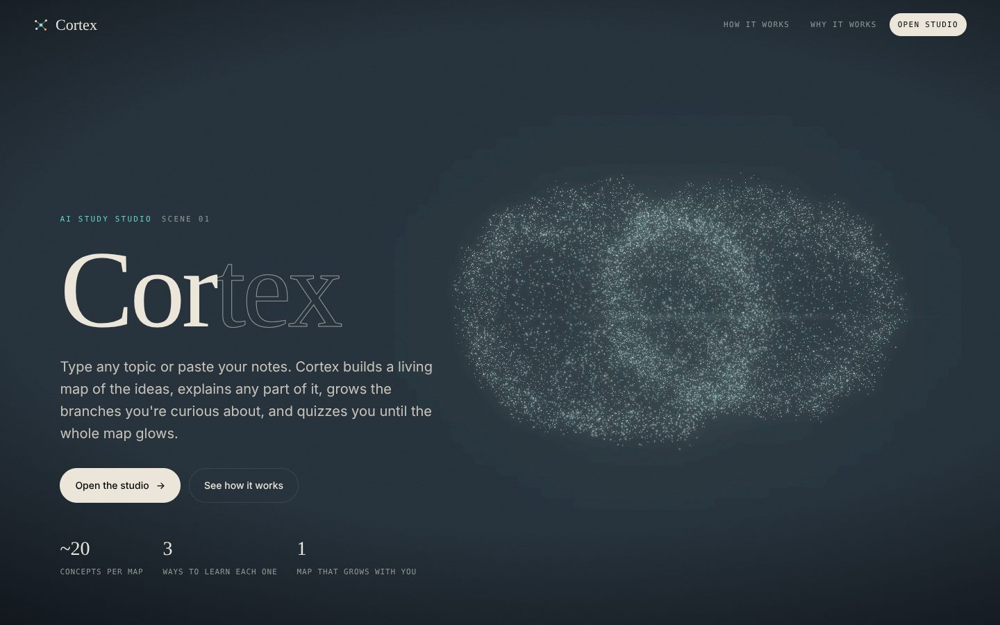
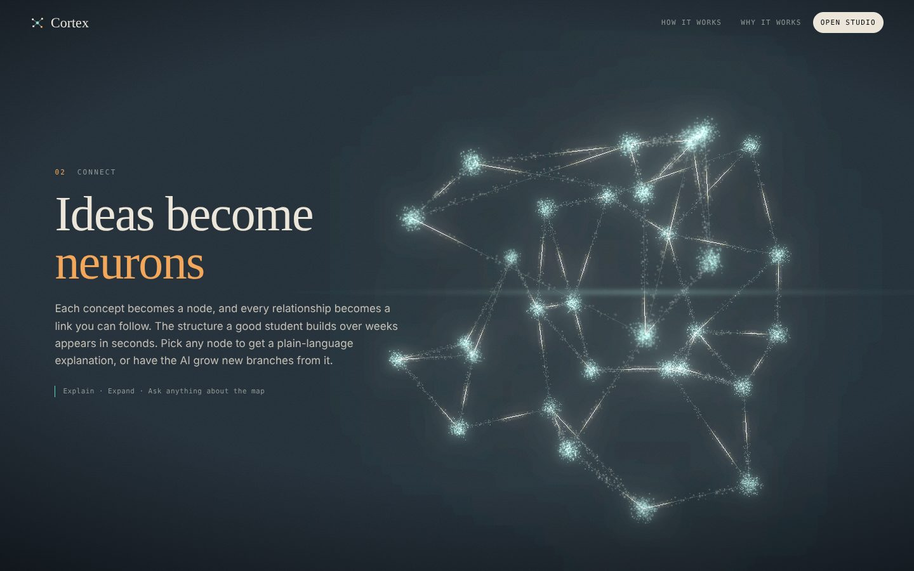
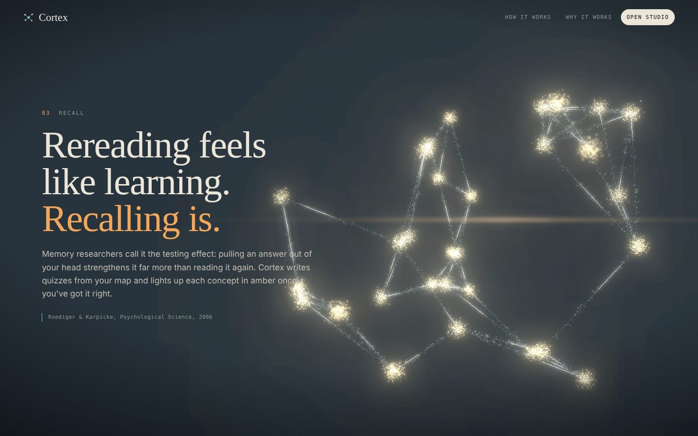
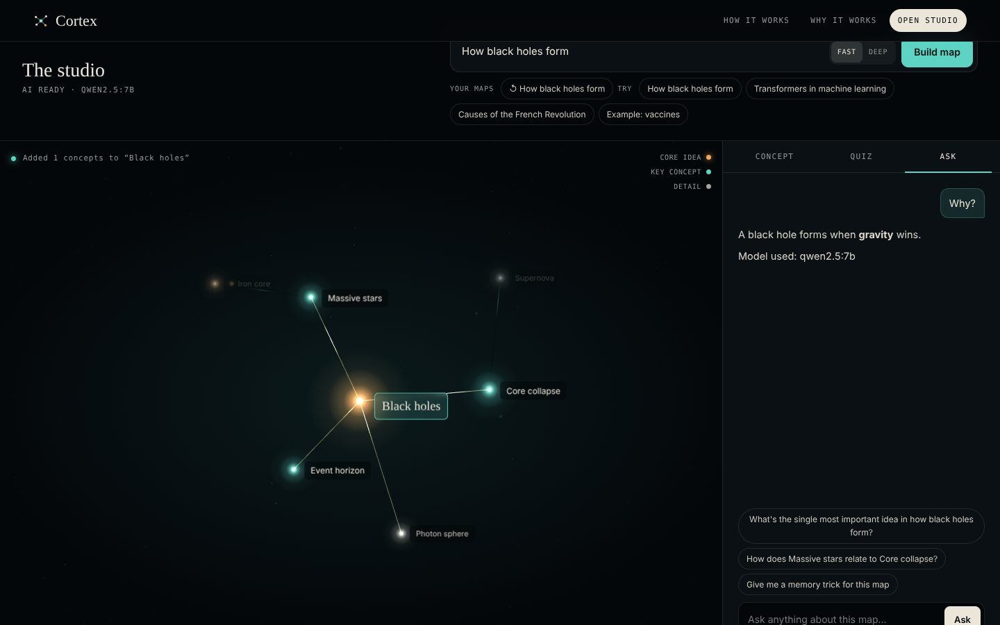

# Cortex Studio

**Turn any topic or your own notes into a living 3D map of ideas, then explore it, grow it, get quizzed on it, and chat with it. Runs on free, open-source AI models.**



Cortex Studio is an AI study tool with a cinematic WebGL frontend. You type a topic (or paste a chapter of notes), and an open-source language model breaks it into a concept map: one core idea, its key concepts, the details under each, and the links between them. The map renders as a field of glowing neurons with signals travelling along every connection.

| Read → Connect | Recall | The studio |
|---|---|---|
|  |  |  |

## Features

- **Build a map** from a topic or pasted notes. Concepts appear in the 3D scene *while the model is still writing*, then settle into a force-directed layout you can orbit and zoom.
- **Explain deeper** gives a streamed, plain-language explanation of any concept with an example and a link to the rest of the map.
- **Expand branch** asks the model for 3–5 new sub-concepts and grows them out of the selected node.
- **Quiz me** writes multiple-choice questions from the map, either for a single concept or the whole thing. Concepts you answer correctly turn amber and fill the mastery bar.
- **Ask** is a chat that knows the whole map as context.
- **Your maps** are saved in the browser (localStorage) so you can reopen them.
- **Cinematic landing page**: a scroll-driven particle film (neuron cloud → page of text → network → recall), scrambled-text headings, film grain, depth of field, bloom and an anamorphic lens flare.
- **Works offline-first**: a built-in example map (how vaccines train immunity) is fully explorable without any model.

## Tech

| Part | What it uses |
|---|---|
| Frontend | `public/`: plain HTML, CSS and vanilla JS, [three.js](https://threejs.org) r147 with UnrealBloom post-processing, custom GLSL shaders |
| Server | `server.js`: zero dependencies, Node.js 18+. Serves the page and proxies `/api/chat` to the model, streaming text back |
| AI | Any **OpenAI-compatible** endpoint. Default: **[Ollama](https://ollama.com)** running locally with `qwen2.5:7b` (free, open-source, no API key) |

No build step, no `node_modules`.

## Quick start (free, local, open-source)

**1. Install Ollama and pull a model**

Download Ollama from [ollama.com/download](https://ollama.com/download), then:

```bash
ollama pull qwen2.5:7b
```

`qwen2.5:7b` is a good default: it follows JSON instructions reliably and runs on most laptops with 8 GB+ of RAM. Other open models work too (see [Choosing a model](#choosing-a-model)).

**2. Clone and run**

```bash
git clone https://github.com/<your-username>/cortex-studio.git
cd cortex-studio
cp .env.example .env      # optional — defaults already point at Ollama
npm start
```

**3. Open** [http://localhost:3000](http://localhost:3000), scroll to the studio, and press **Build map**.

> Ollama must be running (the desktop app starts it automatically, or run `ollama serve`). The studio header shows `AI READY · QWEN2.5:7B` when it's connected.

## Choosing a model

Set `AI_MODEL` in `.env`. Any chat model Ollama can run will work; bigger models make better maps but answer more slowly.

| Model | Pull command | Notes |
|---|---|---|
| Qwen 2.5 7B | `ollama pull qwen2.5:7b` | **Default.** Strong at structured JSON |
| Llama 3.1 8B | `ollama pull llama3.1:8b` | Good general explanations |
| Qwen 2.5 3B | `ollama pull qwen2.5:3b` | Faster on low-end machines |
| Qwen 2.5 14B | `ollama pull qwen2.5:14b` | Better maps if you have 16 GB+ RAM |

You can also use a lighter model for the quick actions (explain, quiz, chat) and a bigger one for building maps:

```env
AI_MODEL=qwen2.5:14b        # used when "Deep" is selected
AI_MODEL_FAST=qwen2.5:7b    # used for "Fast" maps, explain, expand, quiz, ask
```

## Using a free hosted provider instead

The server speaks the OpenAI-compatible chat API, so you can point it at a hosted provider that serves open-source models on a free tier. That's useful when deploying or when your computer is too slow for local models.

```env
# Groq (free tier, very fast) — get a key at https://console.groq.com
AI_BASE_URL=https://api.groq.com/openai/v1
AI_API_KEY=your_key_here
AI_MODEL=<a model id from Groq's model list>

# OpenRouter (offers some open models for free) — https://openrouter.ai
AI_BASE_URL=https://openrouter.ai/api/v1
AI_API_KEY=your_key_here
AI_MODEL=<a model id ending in :free from OpenRouter's model list>
```

Model ids and free-tier limits change often, so copy a current id from the provider's model page. The API key stays on the server and is never sent to the browser.

## Configuration

All settings are optional environment variables (or lines in `.env`):

| Variable | Default | Purpose |
|---|---|---|
| `PORT` | `3000` | Port for the web server |
| `AI_BASE_URL` | `http://localhost:11434/v1` | OpenAI-compatible endpoint (Ollama by default) |
| `AI_API_KEY` | *(empty)* | Bearer key for hosted providers. Not needed for Ollama |
| `AI_MODEL` | `qwen2.5:7b` | Model for "Deep" map building |
| `AI_MODEL_FAST` | same as `AI_MODEL` | Model for "Fast" maps and quick actions |
| `AI_MAX_TOKENS` | `2500` | Max tokens per answer |
| `RATE_LIMIT_PER_MIN` | `30` | Requests per minute per IP (protects a public deployment) |
| `AI_APP_URL` | *(empty)* | Your site URL, sent as `HTTP-Referer` (OpenRouter likes this) |

## Deploying

The app is one Node process with no dependencies, so any Node host works (Render, Railway, Fly.io, a VPS):

- **Build command:** none
- **Start command:** `npm start`
- **Environment:** set `AI_BASE_URL`, `AI_API_KEY` and `AI_MODEL` for a hosted provider (a cloud server can't reach the Ollama on your laptop)

## Project structure

```
cortex-studio/
├── public/
│   ├── index.html         # page markup: landing scenes + studio layout
│   ├── css/style.css      # all styles (tokens, landing, studio, quiz, chat)
│   └── js/
│       ├── core.js        # helpers, heading scramble, AI client
│       ├── background.js  # scroll-driven particle film (three.js + bloom)
│       └── studio.js      # 3D concept map, inspector, quiz, chat
├── server.js              # static server + streaming /api/chat proxy
├── docs/              # screenshots for this README
├── .env.example
├── package.json
└── LICENSE
```

### How the AI call works

1. The browser posts `{messages, tier}` to `/api/chat`.
2. `server.js` adds a short system prompt, picks `AI_MODEL` or `AI_MODEL_FAST`, and calls `POST {AI_BASE_URL}/chat/completions` with `stream: true`.
3. It reads the server-sent events and forwards only the text to the browser as a plain streamed response.
4. The page renders text as it arrives. For maps, it watches the stream for `"label"` fields so concepts appear before the JSON is complete, then parses the final JSON leniently (raw, fenced, or the outermost `{…}` / `[…]`).

`GET /api/health` reports whether the model endpoint is reachable, and the page lights up its AI features only when it is.

## Troubleshooting

| Message in the app | Fix |
|---|---|
| `AI OFFLINE · exploring the example map` | Start Ollama (`ollama serve`) or check `AI_BASE_URL`, then reload |
| *That model isn't installed* | Run `ollama pull <AI_MODEL>` |
| *The answer came back in a shape Cortex couldn't read* | Small models occasionally break JSON. Try again, or use a larger model such as `qwen2.5:14b` |
| *The AI provider rejected the API key* | Check `AI_API_KEY` for your hosted provider |

## Notes

- AI answers can be wrong. Treat the map as a study aid, and check anything important against a trusted source.
- The testing effect mentioned on the landing page refers to Roediger & Karpicke, *Psychological Science*, 2006.

## License

[MIT](LICENSE)
